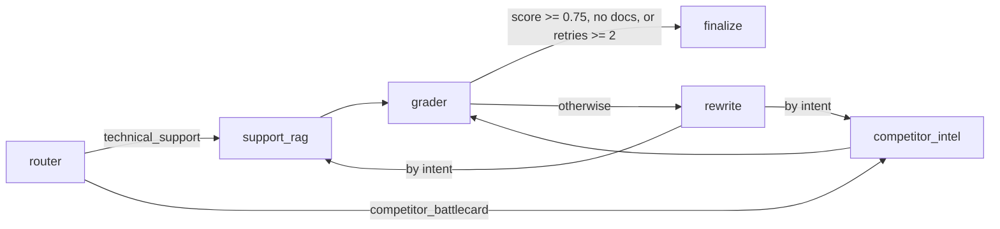

# chameleon

Paste any startup's domain. Chameleon indexes its public site and docs, then answers questions through a small LangGraph agent graph with a live, streaming trace.

## Run

```bash
python -m venv .venv && .venv/Scripts/activate   # or source .venv/bin/activate
pip install -r requirements.txt
cp .env.example .env                             # set GOOGLE_API_KEY and ADMIN_API_KEY
uvicorn app.main:app --port 7860                 # UI at http://localhost:7860
pytest
python -m eval.run_eval                          # needs GOOGLE_API_KEY and ingested companies
```

On startup, companies in `seed/companies.json` are ingested in the background if missing.

## Graph



The grader (smaller model, `GRADER_MODEL`) lists atomic claims and flags each as supported or not; the score is computed in code (`supported / total`). `rewrite` is the only place `retries` increments. Below 0.75 after retries, `finalize` returns a "Confidence low … Flagging a human engineer" message.

## API

| Route | Notes |
|---|---|
| `POST /ingest` | `X-API-Key` must equal `ADMIN_API_KEY`; 5/hour |
| `GET /stream?domain=&query=` | SSE; 10/min per IP plus global `DAILY_QUERY_CAP` |
| `GET /companies` | Ingested domains with page and chunk counts |

## Eval results

Ran against `eval/qa.jsonl` (6 questions across `resend.com`, `supabase.com`, and `posthog.com`):
- **Answerable correct**: 100.0% (4/4 passed independent keyword verification and cited sources)
- **Unanswerable correctly refused**: 100.0% (2/2 accurately refused ungrounded queries like CEO favorite color and unindexed historical revenue)
- **Average retries**: 0.0
- Detailed test cases and answers recorded in `eval/results.json`.

## Choices where the spec was ambiguous

- The FastAPI app also serves `frontend/` at `/`, so one container runs everything. `API_BASE` in `index.html` can point elsewhere.
- Router and rewrite use Gemini 2.5 Flash; only the grader uses the smaller model.
- `/companies` also returns `pages` and an optional `example` question (from the seed file) for the UI.
- Competitor discovery: web-search for competitors, then an LLM call names the top 2 from that evidence.
- When nothing is retrieved, the grader skips its LLM call, scores 0.0, and the graph finalizes with the safe-failure message.
- Prices in `app/agents.py` (`PRICES`) are my best estimate; verify against current Gemini pricing.

## Known Limitations

- The groundedness score is an LLM-judge estimate, not a guarantee.
- Up to 15 public pages per company; JavaScript-heavy or login-gated pages may come back empty from Jina.
- Rate limiting is per client IP as seen by the app (behind a proxy, configure forwarded headers); the daily cap and limiter state are in memory and reset on restart.
- Chroma data is local disk; on ephemeral hosts seed companies are re-ingested at startup.
- Web search for competitors (`ddgs`) is best-effort and can return nothing or irrelevant results.
- EventSource can't read HTTP status codes, so the UI shows one combined message for 404/429 stream failures.
