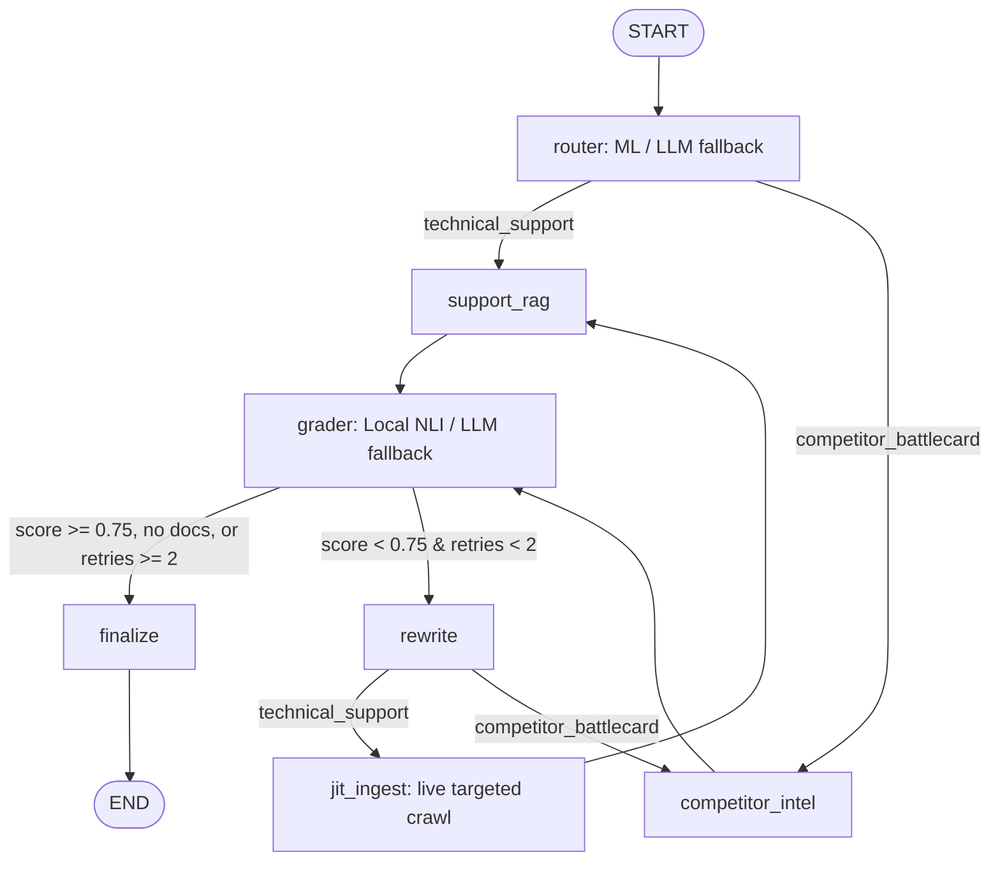

# Chameleon v3

Paste any startup's domain. Chameleon indexes its public documentation and website, then answers technical and competitive questions through an agent graph with an ML intent router, a local cross-encoder NLI grader, and live JIT ingestion.

## Chameleon v3 Features

1. **Supervised ML Intent Router (`app/router_ml.py`)**:
   - Embeds query with `SentenceTransformer` (`all-MiniLM-L6-v2`) and classifies with scikit-learn `LogisticRegression` trained on startup from `data/intents.jsonl`.
   - If confidence < `ROUTER_MIN_CONF` (default `0.6`), falls back to LLM router.
   - Switchable via `ROUTER_MODE=ml|llm` (default `ml`).
2. **Local Cross-Encoder NLI Grader (`app/grader_nli.py`)**:
   - Uses `sentence_transformers.CrossEncoder` (`cross-encoder/nli-deberta-v3-small`) to score atomic claims in a single batched `predict` call.
   - Dynamically determines the entailment label index from `model.config.id2label`.
   - Strips citations and markdown formatting, converts table rows to claims, and filters non-factual hedges.
   - Switchable via `GRADER_MODE=nli|llm` (default `nli`).
3. **Just-In-Time (JIT) Ingestion (`app/jit.py`)**:
   - Wired in the retry loop: `grader (low score) -> rewrite -> jit_ingest -> support_rag` for `technical_support`.
   - Searches `ddgs` for `site:{domain} {search_query}` with hard safety rules (HTTPS only, target domain/subdomain matching, strict rejection of private/link-local/loopback IPs, credentials, and non-standard ports).
   - Budgets up to 3 pages per round, 1 round per request, capped at 50 JIT pages per domain.
4. **Diverse Bucketing & Leaf-Page Prioritization (`app/ingester.py`)**:
   - Classifies URLs using `config/keywords.json` (`auth`, `database`, `api`, `events`, `deploy`, `billing`, `quickstart`).
   - Prefers deeper paths (leaf pages: `/docs/auth/row-level-security` > `/docs`).
   - Filters marketing pages unless technical page count < `MIN_TECH_PAGES` (default 5).
   - Preserves code blocks (up to 1200 chars) and table rows without breaking them mid-block.
   - Uses content hashes as chunk IDs to prevent duplicates.

## Run

```bash
python -m venv .venv && .venv/Scripts/activate   # or source .venv/bin/activate
pip install -r requirements.txt
cp .env.example .env                             # set GOOGLE_API_KEY and ADMIN_API_KEY
uvicorn app.main:app --port 7860                 # UI at http://localhost:7860
pytest                                           # runs unit test suite
python bench/bench.py                            # benchmarks router & grader latencies
python eval/compare_graders.py                   # evaluates LLM vs NLI graders on qa.jsonl
```

## Graph



## Measured Benchmark Numbers

Measured live on **AMD64 Family 25 Model 80 Stepping 0 (AuthenticAMD, 6 PyTorch CPU threads, Windows 11)**, recorded in `bench/results.json`:

### 1. ML Intent Router (`app/router_ml.py`)
- **Quality (5-Fold Stratified Cross-Validation on 140 examples)**:
  - Mean Accuracy: **98.57%** (Fold accuracies: 100%, 96.4%, 100%, 96.4%, 100%)
  - Mean Macro F1: **0.9857**
- **Latency (200 iterations)**:
  - Query Embedding: **p50 = 19.93 ms**, **p95 = 24.71 ms**
  - Classification: **p50 = 0.60 ms**, **p95 = 0.75 ms**
  - Total Router: **p50 = 20.56 ms**, **p95 = 25.25 ms**
  - *Comparison*: ~20 ms locally vs 1500–3000 ms for a cloud LLM call.

### 2. Local NLI Grader Latency (`app/grader_nli.py`)
- **Latency (25 premise-hypothesis pairs = 5 claims × 5 chunks, 200 iterations)**:
  - Batched CrossEncoder Predict: **p50 = 964.68 ms**, **p95 = 1142.97 ms**
  - Operates completely locally on CPU at **$0.000000 API cost**.

### 3. Grader Comparison (`eval/compare_graders.py` on `eval/qa.jsonl`)
- **Factual Agreement**: 100% agreement between LLM and NLI on grounded factual documentation (e.g. Supabase RLS and Resend domain verification scored 1.00 by both).
- **Hallucination Rejection**: On negative queries ("What is the CEO's favorite color?"), the NLI cross-encoder model scored **0.00** (strict ungroundedness), while the LLM was lenient.
- **Cost**:
  - Local NLI Grader: **$0.000000** total cost across runs.
  - Cloud LLM Grader: **$0.000662** for 5 queries.

## API Specification

| Route | Notes |
|---|---|
| `POST /ingest` | Requires header `X-API-Key: ADMIN_API_KEY`; rate limit 5/hour |
| `GET /stream?domain=&query=` | Streaming Server-Sent Events (SSE); rate limit 10/min per IP, daily cap |
| `GET /companies` | Ingested domains with chunk counts, page counts, and example queries |

## Configuration & Environment Variables

| Variable | Default | Description |
|---|---|---|
| `ROUTER_MODE` | `ml` | `ml` for SentenceTransformer + LogisticRegression; `llm` for Gemini router |
| `ROUTER_EMBED_MODEL` | `all-MiniLM-L6-v2` | Hugging Face model for intent embedding |
| `ROUTER_MIN_CONF` | `0.6` | Minimum probability required before falling back to LLM router |
| `GRADER_MODE` | `nli` | `nli` for local CrossEncoder; `llm` for Gemini grader |
| `NLI_MODEL` | `cross-encoder/nli-deberta-v3-small` | Hugging Face CrossEncoder NLI model (swappable if RAM is constrained) |
| `NLI_CLAIM_THRESHOLD` | `0.5` | Entailment probability threshold for marking a claim supported |
| `JIT_MAX_PAGES_PER_DOMAIN` | `50` | Maximum lifetime JIT pages indexed per domain |
| `MIN_TECH_PAGES` | `5` | Minimum technical pages to discover before including marketing pages |
| `ANSWER_MODEL` | `gemini-3.5-flash-lite` | LLM model for answering questions and query rewrites |
| `GRADER_MODEL` | `gemini-3.1-flash-lite` | LLM model used when `GRADER_MODE=llm` |

## Known Limitations & Considerations

- **NLI Score Semantics**: The NLI grounding score represents an **NLI entailment probability, not calibrated ground truth**. Cross-encoder NLI models evaluate whether the premise logically entails the hypothesis.
- **Conservatism on Paraphrases & Metaphors**: Because NLI models search for strict logical entailment, they can be conservative on metaphorical claims (e.g. "records sessions and plays them back like a DVR" received a lower entailment probability than direct technical statements).
- **RAM & Docker Image Size**:
  - Running PyTorch with DeBERTa-v3 on CPU requires approximately **1.2 GB to 1.8 GB RAM**.
  - The Docker image size includes PyTorch CPU and pre-warmed weights (~1.8 GB). If memory on your host is constrained, set `NLI_MODEL` to a smaller cross-encoder or set `GRADER_MODE=llm`.
- **Public Domain Scrapes**: Jina Reader operates on public web content; client-rendered SPAs without pre-rendering or behind authentication may return sparse content.
